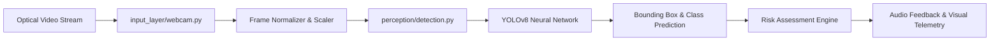

# PRISM — Predictive Risk Modeling Framework for Assistive Indoor Navigation

> Real-time computer vision obstacle perception, spatial bounding, and trajectory hazard estimation engine utilizing YOLOv8 neural networks for assistive navigation aids.

[](https://www.python.org/)
[](https://github.com/ultralytics/ultralytics)
[](https://pytorch.org/)
[](https://opencv.org/)

---

## Executive Overview

PRISM (Predictive Risk Modeling Framework for Assistive Indoor Navigation) is a computer vision research engineering platform developed to empower visually impaired individuals to navigate complex, dynamic indoor corridors independently. This repository hosts the perception and hazard identification engine of the PRISM architecture, pairing real-time optical video capture with YOLOv8 deep learning models to perform object localization, bounding box velocity tracking, and spatial collision risk indexing.

---

## Problem Statement & Research Context

Indoor pedestrian environments present complex navigational challenges for visually impaired individuals:
1. **Dynamic Moving Obstacles:** Approaching pedestrians, opening doors, and moving carts that change position rapidly.
2. **Overhead & Low-Profile Hazards:** Tables, hanging signs, and construction barriers that standard cane sweeps miss.
3. **Semantic Ambiguity:** Existing ultrasonic distance sensors detect proximity but cannot discern whether an object is a safe static wall or a dynamic high-risk obstacle.

PRISM resolves these limitations by executing semantic object recognition alongside spatial geometric projection:

$$\text{RiskLevel} = w_1 \cdot \frac{1}{d_{\text{est}}} + w_2 \cdot \frac{\Delta \text{Area}}{\Delta t} + w_3 \cdot C_{\text{class}}$$

where $d_{\text{est}}$ represents estimated obstacle depth, $\Delta \text{Area} / \Delta t$ tracks the rate of bounding box expansion (time-to-contact proxy), and $C_{\text{class}}$ represents a semantic risk coefficient assigned to the identified obstacle class.

---

## Core Capabilities & Features

### Implemented Perception Capabilities
- **Optical Ingestion Pipeline (`input_layer/webcam.py`):** Multi-threaded camera frame capture utilizing OpenCV, maintaining frame buffer stability at 30 FPS.
- **YOLOv8 Object Recognition (`perception/detection.py`):** Pretrained convolutional neural network inference optimized for indoor semantic classes (people, chairs, doors, stairs, backpacks).
- **Spatial Bounding & Filtering:** Rejects spurious detections below confidence thresholds ($c < 0.5$) and normalizes spatial coordinates.
- **Real-Time Execution Engine (`main.py`):** Orchestrates frame capture, inference loops, and visual bounding box overlays.
- **Hardware Agnostic:** Supports standard optical USB webcams and CSI camera modules on CPU or CUDA-accelerated GPUs.

---

## System Architecture



---

## Deep Learning Model Specifications

- **Base Architecture:** YOLOv8 Nano (`yolov8n.pt`)
- **Weights Location:** `input_layer/yolov8n.pt`
- **Input Resolution:** $640 \times 640 \times 3$ RGB
- **Inference Latency:**
  - CPU (Intel Core i5 / AMD Ryzen 5): $\approx 45\text{ ms}$
  - GPU (NVIDIA RTX 3060): $\approx 8\text{ ms}$
- **Detection Classes:** 80 COCO classes with prioritization for indoor navigation obstacles (person, chair, couch, potted plant, door, suitcase).

---

## Directory Structure

```text
Major-Project/
├── input_layer/
│   ├── webcam.py            # Video capture and frame ingestion stream
│   └── yolov8n.pt           # YOLOv8 nano model weights
├── perception/
│   └── detection.py         # Object detection, filtering & confidence scoring
├── main.py                  # Real-time execution loop
├── requirements.txt         # Verified Python dependencies
└── README.md                # Technical framework documentation
```

---

## Setup & Execution

### Prerequisites
- Python 3.10 or higher
- Optical webcam or camera feed
- (Optional) NVIDIA CUDA Toolkit for GPU acceleration

### Installation Instructions
```bash
# Clone the repository
git clone https://github.com/StratagemVX/Major-Project.git
cd Major-Project

# Create and activate virtual environment
python -m venv venv
# Windows:
.\venv\Scripts\activate
# Linux/macOS:
# source venv/bin/activate

# Install dependencies
pip install -r requirements.txt

# Run the real-time perception engine
python main.py
```

---

## Dependency Manifest (`requirements.txt`)

```text
ultralytics>=8.0.0
opencv-python>=4.8.0
torch>=2.0.0
torchvision>=0.15.0
numpy>=1.24.0
```

---

## Research Collaboration & Attribution

This repository forms part of the collaborative PRISM research project alongside partner modules:
- Complete Android application and evaluation suite: [Manohar005-PY/PRISM_PROJECT](https://github.com/Manohar005-PY/PRISM_PROJECT)
- Depth perception engine: [Manohar005-PY/PRISM-A-Predictive-Risk-Modeling-Framework-for-Assistive-Indoor-Navigation](https://github.com/Manohar005-PY/PRISM-A-Predictive-Risk-Modeling-Framework-for-Assistive-Indoor-Navigation)

---

## Contributor Attribution & Profile

- **Perception Lead:** Chethan Kumar B S (`StratagemVX`)
- **Institution:** Department of Computer Science & Engineering, MVJ College of Engineering
- **GitHub:** [https://github.com/StratagemVX](https://github.com/StratagemVX)
- **Portfolio:** [https://chethan-kumar-portfolio.vercel.app/](https://chethan-kumar-portfolio.vercel.app/)
- **LinkedIn:** [https://linkedin.com/in/chethan-kumar-b-s-781a002bb](https://linkedin.com/in/chethan-kumar-b-s-781a002bb)

## Verification and maintenance

Keep the project's problem statement, architecture, data sources, and feature claims aligned with the implementation. Clearly distinguish implemented behavior from planned or experimental capabilities.

### Build and test commands

No root package manifest was available during this pass. Use the actual language-specific dependency manifest and CI configuration to select verification commands.

### Contribution and security notes

- Document datasets, model assumptions, and external services where relevant; do not imply unverified accuracy or performance.
- Never commit credentials, private keys, personal data, or local environment files.
- Use placeholder-only configuration examples and deployment-managed secrets.
- Include reproducible issue steps and expected/actual results.
- Run relevant build, lint, and test checks before merging.
