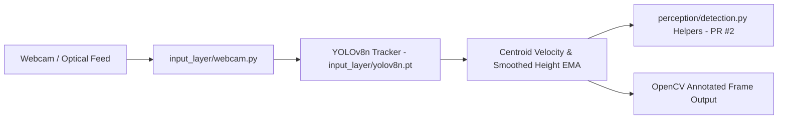

# PRISM — Assistive Indoor Perception & Motion Tracking Prototype

> Real-time object detection, bounding-box tracking, and approach-velocity estimation prototype built with Python, YOLOv8 (`ultralytics`), PyTorch, and OpenCV.

[](https://www.python.org/)
[](https://github.com/ultralytics/ultralytics)
[](https://pytorch.org/)
[](https://opencv.org/)

---

## Executive Overview

**PRISM** (`Major-Project`) is the computer vision perception module for an assistive indoor navigation concept designed to detect indoor obstacles and track their motion in real time from a webcam stream. Using the YOLOv8 Nano model (`input_layer/yolov8n.pt`) and OpenCV, the perception loop estimates per-track centroid velocity (`vx`, `vy`) and exponentially smoothed bounding-box height expansion rate (`approach_velocity`, in pixels/second) as a visual proxy for approaching objects.

---

## Implemented vs. Planned Capabilities

### Implemented in Current Codebase
- **Live Webcam YOLOv8 Tracking (`input_layer/webcam.py`):** Captures optical frames via OpenCV, runs Ultralytics YOLOv8 tracking (`model.track(..., persist=True)`), draws bounding boxes, tracks per-object IDs, and annotates centroid movement speed and bounding-box height growth rate.
- **Hardware Device Reporting (`main.py`):** Checks PyTorch CUDA availability and reports the active compute device.
- **CPU Fallback, Resource Lifecycle & Pure-Python Geometry Helpers (Open Draft PR #2 — `maintenance/repository-quality-improvements`):**
  - `main.py` calls `get_runtime_summary()` so CPU-only environments no longer crash when calling `torch.cuda.get_device_name()`.
  - `perception/detection.py` implements unit-tested helper functions (`resolve_device`, `resolve_weights_path`, `compute_centroid`, `compute_velocity`, `smooth_height`, `compute_approach_velocity`).
  - `input_layer/webcam.py` resolves `input_layer/yolov8n.pt` relative to the repository root, fails fast if `cv2.VideoCapture` cannot open the camera, and releases capture/windows in `try...finally`.
  - Adds `tests/test_perception_detection.py` (4 `unittest` test cases), `.github/workflows/quality.yml`, and hardened `.gitignore`.

### Collaborative Research Context / Future Roadmap (Not Yet Implemented in This Repo)
- Multi-factor collision `RiskLevel` fusion using calibrated depth sensors (`1 / d_est`).
- Spoken/audio hazard feedback synthesis (belongs to downstream mobile/feedback integration modules).

---

## System Architecture



---

## Model & Dependency Specifications (`requirements.txt`)

- `ultralytics>=8.0.0` (uses bundled `input_layer/yolov8n.pt`)
- `opencv-python>=4.8.0`
- `torch>=2.0.0`
- `torchvision>=0.15.0`
- `numpy>=1.24.0`

---

## Directory Structure

```text
Major-Project/
├── .github/workflows/quality.yml        # Python compile & unittest CI (PR #2)
├── input_layer/
│   ├── webcam.py                        # OpenCV capture + YOLOv8 tracking loop
│   └── yolov8n.pt                       # YOLOv8 Nano model weights
├── perception/
│   ├── __init__.py                      # Package marker (PR #2)
│   └── detection.py                     # Geometry/velocity/device helpers (PR #2; empty placeholder on main)
├── tests/
│   └── test_perception_detection.py     # Unit tests for perception.detection helpers (PR #2)
├── main.py                              # CUDA/CPU device check entrypoint
├── requirements.txt                     # Python dependency manifest
└── README.md                            # Project documentation
```

---

## Setup, Execution & Verification

### Installation
```bash
git clone https://github.com/StratagemVX/Major-Project.git
cd Major-Project

python -m venv .venv
# Windows: .venv\Scripts\activate
# Linux/macOS: source .venv/bin/activate

pip install -r requirements.txt
```

### Running Locally
```bash
# Check PyTorch CUDA / CPU device detection
python main.py

# Run live webcam tracking (requires camera device; press 'q' to quit)
python input_layer/webcam.py
```

### Verification Commands (PR #2 / CI `quality.yml`)
```bash
python -m compileall -q main.py input_layer perception tests
python -m unittest discover -s tests -v
```
- `main` branch status: contains empty `perception/detection.py` and an unguarded CUDA `get_device_name()` call in `main.py` on CPU-only machines.
- Draft PR #2 (`maintenance/repository-quality-improvements`): implements the helpers, CPU fallback, camera cleanup guards, unit tests, and GitHub Actions workflow.

---

## Research Collaboration & Attribution

- **Perception Lead:** Chethan Kumar B S (`StratagemVX`)
- **Partner Modules:**
  - Android application and evaluation suite: [Manohar005-PY/PRISM_PROJECT](https://github.com/Manohar005-PY/PRISM_PROJECT)
  - Depth perception engine: [Manohar005-PY/PRISM-A-Predictive-Risk-Modeling-Framework-for-Assistive-Indoor-Navigation](https://github.com/Manohar005-PY/PRISM-A-Predictive-Risk-Modeling-Framework-for-Assistive-Indoor-Navigation)
- **GitHub:** [https://github.com/StratagemVX](https://github.com/StratagemVX)
- **Portfolio:** [https://chethan-kumar-portfolio.vercel.app/](https://chethan-kumar-portfolio.vercel.app/)
- **LinkedIn:** [https://linkedin.com/in/chethan-kumar-b-s-781a002bb](https://linkedin.com/in/chethan-kumar-b-s-781a002bb)
