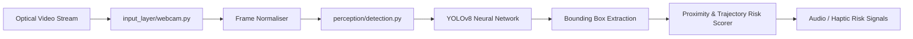

# PRISM — Predictive Risk Modeling Framework for Assistive Indoor Navigation

> Computer Vision Perception & Obstacle Risk Engine utilising YOLOv8 and depth inference for assistive navigation aids.

---

## 1. Project Title
**PRISM: Perception & Risk Modeling Engine** (`Major-Project`) — Real-time Object Detection and Collision Risk Modeling for Assistive Indoor Navigation.

## 2. Project Overview
PRISM is an assistive technology system engineered to empower visually impaired individuals to navigate indoor environments safely. This repository hosts the perception and computer vision risk modeling layer of the PRISM framework, combining real-time camera ingestion, YOLOv8 object recognition, spatial bounding box analysis, and velocity/proximity risk estimation.

## 3. Problem Statement
Indoor environments present severe dynamic hazards for visually impaired individuals, including low-profile obstacles, approaching pedestrians, and architectural bottlenecks. Traditional sensor canes lack semantic scene awareness. PRISM bridges this gap by transforming raw optical video streams into spatial risk assessments.

## 4. Objectives
- **Implemented:**
  - Real-time video ingestion from optical webcams and camera feeds (`input_layer/webcam.py`).
  - Pretrained YOLOv8 neural network inference for indoor object classification (`yolov8n.pt`).
  - Spatial perception and risk bounding evaluation (`perception/detection.py`).
  - Central execution pipeline orchestrating real-time hazard detection (`main.py`).
- **Research Collaboration:**
  - Integrates with the broader PRISM suite including Android client applications and simulation benches.

## 5. Technology Stack
- **Language:** Python 3.10+
- **Deep Learning / Computer Vision:** Ultralytics YOLOv8, OpenCV (`cv2`), PyTorch, Torchvision
- **Data & Numerical Processing:** NumPy
- **Device Support:** CPU and CUDA-compatible GPUs

## 6. System Architecture


## 7. Folder Structure
```
Major-Project/
├── input_layer/
│   ├── webcam.py            # Video capture and frame ingestion stream
│   └── yolov8n.pt           # YOLOv8 nano model weights
├── perception/
│   └── detection.py         # Object detection, filtering & confidence scoring
├── main.py                  # Real-time execution loop
├── requirements.txt         # Verified Python dependencies
└── README.md                # Technical framework documentation
```

## 8. Installation & Setup
```bash
# Clone the repository
git clone https://github.com/StratagemVX/Major-Project.git
cd Major-Project

# Set up virtual environment
python -m venv venv
.\venv\Scripts\activate   # Windows

# Install required dependencies
pip install -r requirements.txt

# Run perception engine
python main.py
```

## 9. Hardware & System Requirements
- Standard optical webcam (720p or 1080p).
- 4GB+ RAM, Intel i5/AMD Ryzen 5 or higher.
- CUDA-enabled NVIDIA GPU recommended for sub-30ms inference latency.

## 10. Author & Project Information
- **Lead Developer:** Chethan Kumar B S (`StratagemVX`)
- **Institution:** MVJ College of Engineering
- **Domain:** Artificial Intelligence, Deep Learning & Assistive Robotics
